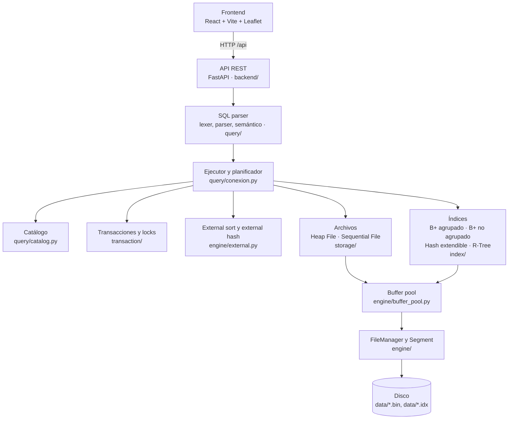
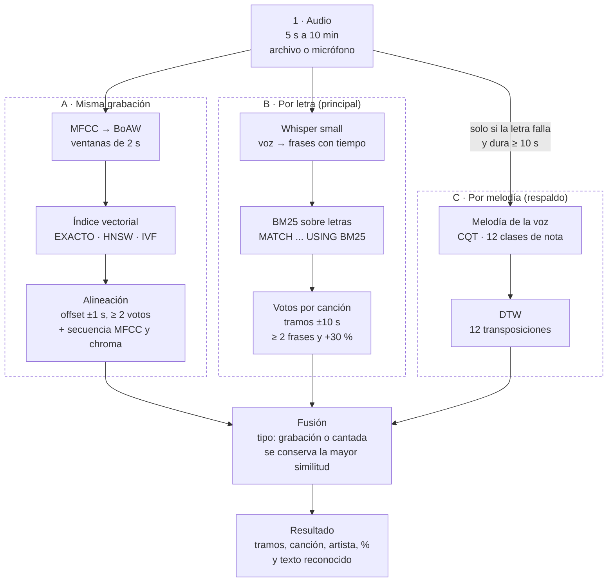
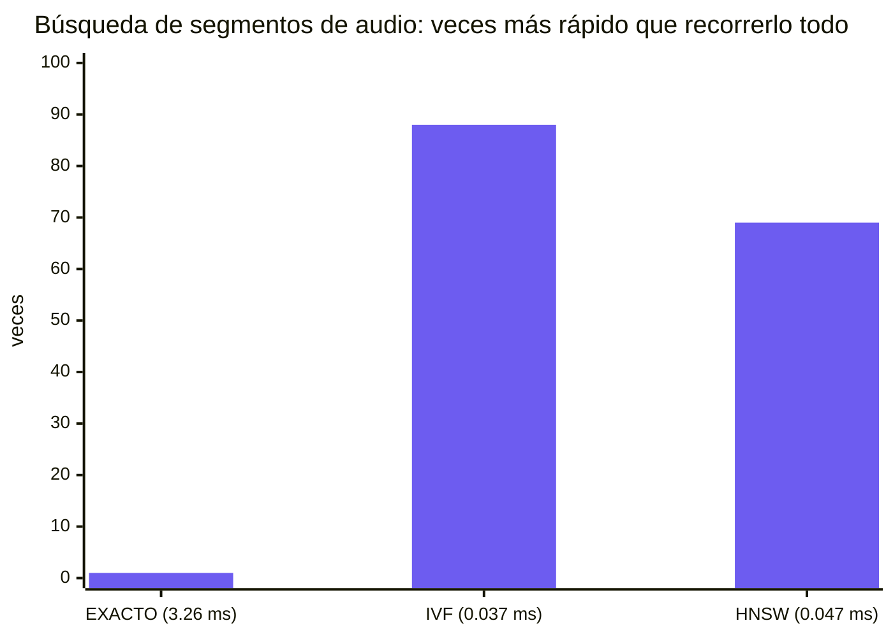

# Minigestor de Base de Datos Multimodal - BD2 (2026-2)

Sistema gestor de base de datos multimodal desarrollado desde cero. Esta versión cubre la Parte 1 (datos relacionales con almacenamiento paginado, índices, SQL, transacciones y algoritmos externos), la Parte 2 (datos espaciales con R-Tree), la Parte 3 (recuperación de información textual con índice invertido SPIMI), la Parte 4 (búsqueda multimedia con BoVW/BoAW sobre HNSW, IVF y búsqueda exacta) y la Parte 5 (recomendación de e-commerce híbrida y detección de copyright en audio, incluido el reconocimiento de canciones cantadas, por su letra y por su melodía).

> **Las aplicaciones de la Parte 5 tienen su propia interfaz.** La Tienda y la detección de copyright se usan desde [Aplicaciones-BD2](https://github.com/iranalvarez27/Aplicaciones-BD2). Este repositorio es el motor: aporta el SQL, los índices, los datos y las librerías (`recomendacion/`, `deteccion/`, `multimedia/`), y expone el API `/api/ecommerce` que consume la Tienda.

---

## Arquitectura del sistema

El sistema está organizado en capas. Una consulta baja desde la interfaz hasta el disco, y cada capa corresponde a un directorio del repositorio.



| Capa | Directorio | Responsabilidad |
|---|---|---|
| Interfaz | `frontend/` | Paneles de archivos, consultas, resultados, plan de ejecución, mapa, inspector físico, búsqueda textual y laboratorio vectorial. |
| API | `backend/` | Recibe el SQL por HTTP (FastAPI) y lo pasa al motor a través de `EngineAdapter`, que también arma el plan que se muestra en la interfaz. |
| SQL | `query/` | El lexer y el parser convierten el texto en un AST, el analizador semántico valida tablas, columnas y tipos, y `conexion.py` elige el plan y lo ejecuta. |
| Catálogo | `query/catalog.py`, `query/catalog_store.py` | Registra las tablas, su organización física y sus índices, y los persiste en `data/catalog.json`. |
| Transacciones | `transaction/` | Locks compartidos y exclusivos por tabla, `BEGIN TRANSACTION`, `END TRANSACTION` (o `COMMIT`) y `ROLLBACK`, verificación de serializabilidad y simulación con hilos. |
| Algoritmos externos | `engine/external.py` | External sort (k-way merge) para `ORDER BY` y external hash para `GROUP BY` y `JOIN`. |
| Archivos | `storage/` | Heap File con reutilización de espacio libre y Sequential File con MAIN, AUX, eliminación lazy y reorganización. |
| Índices | `index/` | B+ Tree agrupado y no agrupado, hash extendible y R-Tree, todos paginados en disco; índices vectoriales en `index/vector/`. |
| Multimedia | `multimedia/`, `index/vector/` | Extracción SIFT/MFCC, vocabulario K-Means y vectores TF-IDF (`ExtractFeatures`); índices EXACTO, HNSW e IVF para `SIMILAR_TO`. |
| Detección de audio | `deteccion/`, `backend/audio_detection.py` | Librería que recupera candidatos, verifica alineación temporal y secuencias MFCC, reconoce canciones cantadas por su letra (Whisper + índice invertido BM25) y, de respaldo, por su melodía, y devuelve coincidencias con metadatos SQL. La sirve `Aplicaciones-BD2`. |
| Recomendación | `recomendacion/`, `backend/ecommerce_recommendation.py` | Catálogo, señales de recomendación, compras transaccionales y el API `/api/ecommerce` que usa la Tienda de `Aplicaciones-BD2`. |
| Almacenamiento | `engine/` | Buffer pool de páginas de 4 KB, `Segment` (archivo de páginas con free list y metapágina) y `FileManager` (lectura y escritura en disco). |
| Común | `common/` | Tipos de datos, slotted page, formato de registros, bitmap de RIDs y funciones geométricas. |

### Flujo de una consulta

1. El frontend envía el SQL y un `session_id` a `POST /api/query`.
2. El lexer produce tokens, el parser construye el AST y el analizador semántico lo valida.
3. El gestor de transacciones toma un lock compartido o exclusivo sobre la tabla.
4. El planificador elige índice, búsqueda secuencial, escaneo completo o algoritmo externo.
5. Los archivos e índices traducen la operación a RIDs y páginas, que se leen y escriben a través del buffer pool.
6. El backend devuelve las filas, el plan y el tiempo de ejecución, y la interfaz los muestra.

---

## Organización del código fuente

```
Proyecto-BD2/
├── backend/                     # API REST
│   ├── main.py                  # Endpoints FastAPI (/api/query, /api/tables, /api/visualize, ...)
│   ├── engine_adapter.py        # Une catálogo, almacenamiento, índices y transacciones; crea las tablas de demo
│   ├── visualize.py             # Snapshots y trazas para el inspector físico
│   ├── ecommerce_recommendation.py  # API /api/ecommerce (lo consume la Tienda de Aplicaciones-BD2)
│   └── audio_detection.py       # Router de audio como librería: lo monta Aplicaciones-BD2, no este servidor
├── common/                      # Lo que comparten todas las capas
│   ├── types.py                 # Tipos de datos, columnas y esquemas
│   ├── page.py                  # Slotted page de 4096 bytes
│   ├── record.py                # Serialización binaria de registros
│   ├── geo.py                   # MBR, Haversine, euclidiana, cotas punto-MBR y punto en polígono
│   ├── bitmap.py                # Bitmap de RIDs para combinar índices y leer cada página una vez
│   └── datos_lima.py            # Generador de puntos de interés en Lima
├── engine/                      # Gestión de almacenamiento y memoria externa
│   ├── file_manager.py          # Lectura y escritura de páginas en disco
│   ├── buffer_pool.py           # Buffer pool de páginas
│   ├── segment.py               # Archivo de páginas con metapágina y free list
│   └── external.py              # External sort y external hash
├── storage/                     # Organización de archivos
│   ├── heap_file.py             # Heap File
│   └── sequential_file.py       # Sequential File (MAIN + AUX, eliminación lazy, reorganización)
├── index/                       # Estructuras de indexación
│   ├── base.py                  # Interfaz común de los índices
│   ├── key_codec.py             # Codificación binaria de claves
│   ├── node_page.py             # Página de nodo del B+ Tree
│   ├── bplus_tree.py            # B+ Tree no agrupado
│   ├── clustered_bplus_tree.py  # B+ Tree agrupado sobre el Sequential File
│   ├── bucket_page.py           # Página de bucket del hash
│   ├── hash_utils.py            # Función de hash de claves
│   ├── extendible_hash.py       # Hash extendible
│   ├── rtree_page.py            # Página de nodo del R-Tree
│   ├── rtree.py                 # R-Tree: radio, rectángulo, polígono, k-NN y carga masiva STR
│   ├── inverted_index.py        # Índice invertido: rankeo TF_IDF / BM25 sobre los postings
│   ├── inverted_store.py        # Archivos .dic / .pst / .doc (diccionario, postings, longitudes y normas)
│   ├── spimi.py                 # Construcción SPIMI: bloques en memoria y mezcla k-way con heap
│   ├── tfidf.py, bm25.py        # Puntajes TF-IDF con coseno y BM25
│   └── vector/                  # Índices vectoriales EXACTO, HNSW e IVF
│       ├── base.py              # Interfaz de los índices vectoriales
│       ├── exacto.py            # k-NN exacto; base de los demás (clave ruta/segmento, n_coleccion, .npz)
│       ├── faiss_base.py, hnsw.py, ivf.py, indices_faiss.py   # HNSW e IVF sobre FAISS
│       ├── metricas.py          # euclidean, cosine, dot
│       └── registro.py          # constructor de cada método
├── query/                       # Procesamiento de consultas SQL
│   ├── tokens.py, lexer.py      # Análisis léxico
│   ├── ast.py, parser.py        # Análisis sintáctico y AST
│   ├── semantic.py              # Análisis semántico
│   ├── catalog.py               # Catálogo de tablas e índices
│   ├── catalog_store.py         # Persistencia del catálogo en data/catalog.json
│   └── conexion.py              # Planificador y ejecutor
├── transaction/                 # Transacciones y concurrencia
│   ├── locks.py                 # Lock manager
│   ├── manager.py               # Transaction manager
│   ├── serializability.py       # Grafo de precedencia
│   └── simulation.py            # Simulación con hilos (race condition y deadlock)
├── text/                        # Recuperación de información textual
│   ├── preprocesamiento.py      # Normalización, stopwords y stemming (NLTK)
│   └── ingesta.py               # Ingesta de CSV a tablas e indexación SPIMI
├── multimedia/                  # Parte 4: extracción de características (BoVW / BoAW)
│   ├── config.py                # Parámetros (K, SEG_S, SIFT, MFCC) y rutas; MULTIMEDIA_DATA
│   ├── sift.py                  # Descriptores SIFT (OpenCV): hasta 500 × 128 por imagen
│   ├── mfcc.py                  # Segmentos de SEG_S s y MFCC por ventana (librosa): 19 coeficientes
│   ├── cache.py                 # Caché de descriptores por id con huella sha1, shards y compactación
│   ├── kmeans.py                # K-Means propio: k-means++ y Lloyd por bloques
│   ├── codebook.py              # Muestreo estratificado, estandarización y vocabulario (codebook)
│   ├── histogramas.py           # Conteos de palabras por objeto (uint16)
│   ├── bovw.py                  # IDF, TF-IDF, colecciones y ExtractFeatures
│   ├── construir.py             # Comando del pipeline completo
│   ├── colecciones_audio.py     # Nombres de datasets y resolución de la tabla de audio
│   └── barrido_k.py             # Precision@10 por K para elegir el tamaño del vocabulario
├── bench/                       # Benchmarks y preparación de datasets reales
│   ├── datasets/                # Descarga, ingesta y unificación: esci.py, amazon_img.py, fma.py, fma_todas.py, musica_propia.py
│   ├── experiments/             # Experimentos de las Partes 3 a 5: texto, vector_compare, vector_params, elegir_k, galeria, tienda_*
│   ├── plots.py                 # Gráficas a partir de los CSV de bench/results/
│   └── data/                    # Almacenamiento local de descargas (excluido de git)
├── data/                        # Datos generados (.bin, .idx, catalog.json) y benchmarks
│   ├── generate_data.py         # Datasets de 1K, 10K y 100K para las Partes 1 y 2
│   ├── benchmark_charts.py      # Benchmark y gráficas de la Parte 1
│   ├── bench_churn_indices.py   # Benchmark de índices con inserciones y eliminaciones frecuentes
│   ├── bench_spatial.py         # Benchmark espacial: secuencial vs R-Tree vs GiST de PostgreSQL
│   ├── plot_spatial.py          # Gráficas de la Parte 2
│   └── charts/                  # Gráficas PNG generadas por los benchmarks
├── deteccion/                   # Detector de copyright (detector.py, chroma.py), modo a cappella (acapella.py), canción cantada por letra (letras.py),
│                                #   biblioteca portable (biblioteca.py, precalcular.py, dividir.py), evaluación (evaluar.py, evaluar_letras.py) y pruebas
├── recomendacion/               # Tienda: catálogo, texto/visual/semántico, metadata, afinidades, fusión, compras,
│                                #   sucursales, disponibilidad, preparación (preparar.py) y pruebas
├── docs/                        # Diagramas animados (SVG) del README
├── tools/
│   └── smoke_visualizations.py  # Snapshots y trazas de las estructuras
├── frontend/                    # Interfaz de usuario (React + Vite + Tailwind CSS + Leaflet)
│   └── src/
│       ├── App.jsx              # Layout y llamadas a la API
│       └── components/          # Paneles (archivos, consultas, resultados, plan, mapa, inspector)
├── docker/, Dockerfile, docker-compose.yml   # Despliegue con un solo comando (PostgreSQL + datasets + motor + interfaz)
├── .env.example                 # Conexión a PostgreSQL para el benchmark espacial
├── requirements.txt             # Dependencias del backend
└── requirements-dev.txt         # Dependencias de datasets, benchmarks y pruebas
```

Todos los archivos de datos se guardan en `data/` y no se suben al repositorio. Cada tabla e índice es un archivo de páginas de 4 KB, por ejemplo `data/tiendas.bin` y `data/tiendas_ubicacion_rtree.idx`.

---

## Manual de instalación

### Requisitos

| Herramienta | Versión | Para qué |
|---|---|---|
| Python | 3.10 o superior | Motor y API |
| Node.js | 20.19+ o 22.12+ | Frontend (Vite 8) |
| pnpm | 9 o superior | Dependencias del frontend (`pnpm-lock.yaml`) |
| PostgreSQL + PostGIS | Opcional | Solo para comparar con GiST en el benchmark espacial |
| FFmpeg | Opcional | Recuperación de MP3 con cabeceras problemáticas y conversión de audio |

Si no tienes pnpm, se puede activar con `corepack enable` (viene con Node) o instalar con `npm install -g pnpm`.

### Opción rápida: Docker

```bash
docker compose up --build
```

Levanta PostgreSQL, genera los datasets, prepara la tienda y arranca el backend (`http://localhost:8000/docs`) y el frontend (`http://localhost:8080`). Las variables opcionales (`TAMANOS`, `FMA_VARIANTE`, `CORRER_EXPERIMENTOS`, `SEED`, `TIENDA`) están descritas al inicio de `docker-compose.yml`. Para instalar a mano, seguir los pasos 1 a 3.

### 1. Clonar el repositorio

```bash
git clone <url-del-repositorio> Proyecto-BD2
cd Proyecto-BD2
```

Todos los comandos de Python se ejecutan **desde la raíz del repositorio**, porque el motor guarda sus archivos en `data/` relativo al directorio actual.

### 2. Backend

```bash
python3 -m venv .venv
source .venv/bin/activate          # En Windows: .venv\Scripts\activate
pip install -r requirements.txt
python3 -m uvicorn backend.main:app --host 127.0.0.1 --port 8000 --reload
```

La API queda en `http://127.0.0.1:8000`, con la documentación Swagger en `http://127.0.0.1:8000/docs`. La primera vez que arranca crea `data/` y las tablas de demostración `estudiantes` (Heap File con B+ sobre `id` y hash sobre `carrera`), `cursos` (Sequential File con B+ agrupado) y `tiendas` (500 puntos en Lima con R-Tree sobre `ubicacion`).

### 3. Frontend

En otra terminal:

```bash
cd frontend
pnpm install
pnpm dev
```

La aplicación queda en `http://127.0.0.1:5173`. Vite redirige las llamadas a `/api` al backend en el puerto 8000, así que el backend tiene que estar corriendo.

### 4. Datos de prueba (opcional)

```bash
python3 data/generate_data.py --size 10k      # tablas de la Parte 1 con 1k, 10k o 100k registros
python3 data/generate_data.py --spatial 100k  # tabla tiendas con 1k, 10k o 100k puntos
python3 data/generate_data.py --reset         # vuelve a los datos de muestra
```

Después de generar datos hay que reiniciar el backend.

### 5. Simulación de concurrencia

```bash
python3 transaction/simulation.py --scenario race       # transacciones compitiendo por las mismas claves
python3 transaction/simulation.py --scenario deadlock   # dos transacciones que se bloquean mutuamente
```

Al final verifica que las claves primarias sigan siendo únicas, que los índices sean coherentes y que el schedule sea serializable.

### 6. Benchmarks y gráficas (opcional)

```bash
pip install matplotlib numpy psycopg2-binary
pip install -r requirements-dev.txt # Incluye pyarrow, pyyaml, pytest, etc. para datasets y benchmarks
```

`matplotlib` y `numpy` hacen falta para las gráficas, y `psycopg2-binary` solo para comparar con PostgreSQL en el benchmark espacial. Para esa comparación:

```bash
cp .env.example .env               # y completar host, port, user, password y dbname
```

El usuario de PostgreSQL necesita poder ejecutar `CREATE EXTENSION postgis`. Los comandos de los benchmarks están en las secciones 2.1.6 y 2.2.4.

---

## 2.1.5 Interfaz de Usuario

Los cuatro paneles base permiten consultar el motor y revisar sus estructuras. Las pestañas adicionales incorporan búsqueda textual, multimedia y datos espaciales. La Tienda y la detección de copyright están en `Aplicaciones-BD2`.

1. **Panel de Archivos (Izquierda):**
   * Inspección de tablas cargadas (`HEAP` y `SEQUENTIAL`).
   * Columnas, tipos de datos (`INT`, `VARCHAR`, etc.) y llaves primarias.
   * Índices activos (B+ Tree Agrupado, B+ Tree No Agrupado, Extendible Hash).
   * Métricas de disco en vivo: conteo de páginas de 4KB, conteo de tuplas y ratio de espacio desperdiciado por eliminación lazy.
   * Botón de **Reorganización** automática cuando el desperdicio supera el 30%.

2. **Panel de Consultas (Superior Centro):**
   * Editor de sentencias SQL multilínea con atajo `Cmd/Ctrl + Enter`.
   * Menú desplegable con plantillas rápidas (`SELECT`, `INSERT`, `ORDER BY`, `TRANSACTIONS`).
   * Botones: **Ejecutar**, **Cargar CSV** y **Limpiar** (usa `EXPLAIN` / `EXPLAIN ANALYZE` directamente en la consola SQL para ver el plan de ejecución).
   * Historial de consultas ejecutadas.

3. **Panel de Resultados (Inferior Centro):**
   * Tabla dinámica de resultados con formateo de tipos y números de fila.
   * Indicadores de latencia (`ms`) y número de filas devueltas/afectadas.
   * Exportación instantánea a **CSV** o **JSON**.
   * Detección y visualización amigable de errores.

4. **Panel del Plan de Ejecución (Pestaña dedicada):**
   * Representación visual en árbol de la estrategia del planificador de consultas.
   * Muestra nodos jerárquicos: `IndexScan (B+ Tree Agrupado)`, `IndexScan (B+ Tree No Agrupado)`, `IndexScan (Extendible Hash)`, `SequentialBinarySearch`, `FullTableScan`, `Sort (ORDER BY)`.
   * Costos estimados de E/S y conteo de filas estimadas.

Las pestañas **Mapa**, **Búsqueda textual**, **Laboratorio vectorial** e **Inspector físico** amplían estas herramientas. La biblioteca musical aparece con su nombre descriptivo junto a las tablas de origen y las muestras de audio.

---

## 2.1.6 Comparación Experimental de Técnicas (Guía de Benchmark)

Esta sección permite reproducir los experimentos comparativos requeridos en la rúbrica entre las técnicas de almacenamiento físico e indexación.

### Paso 1: Generar Datasets Sintéticos (1K, 10K, 100K)
Usa el script `data/generate_data.py` para poblar las tablas con datos realistas:
```bash
# Modo interactivo (menú en consola):
python3 data/generate_data.py

# O por argumento directo:
python3 data/generate_data.py --size 1k     # 1 000 registros
python3 data/generate_data.py --size 10k    # 10 000 registros (recomendado)
python3 data/generate_data.py --size 100k   # 100 000 registros
python3 data/generate_data.py --stats       # Ver espacio en disco ocupado
python3 data/generate_data.py --reset       # Restaurar a datos de muestra iniciales
```

> **Métricas obtenidas en este paso:** El generador mide y reporta en consola:
> * **Tiempo de inserción masiva** (HeapFile vs SequentialFile).
> * **Tiempo de construcción de índices** (B+ no agrupado, Hash dinámico, B+ agrupado).
> * **Espacio en disco utilizado y espacio adicional requerido** (tamaño en KB/MB de `.bin` y `.idx`).

### Paso 1b: Benchmark completo + gráficas (`data/benchmark_charts.py`)

`generate_data.py` solo puebla `data/` y mide inserción/construcción por consola. Para las métricas que faltan (búsqueda por clave primaria, reorganización, búsqueda por igualdad/rango/orden en cada índice) y las gráficas comparativas, usa el runner dedicado — construye sus propios archivos temporales, no toca los datos de `data/`:

```bash
# Benchmark completo (1K, 10K, 100K) + 4 gráficas PNG:
python3 data/benchmark_charts.py --sizes 1k 10k 100k --plot

# Prueba rápida (sólo 1K):
python3 data/benchmark_charts.py --sizes 1k --plot

# Rendimiento con inserciones/eliminaciones frecuentes (churn) sobre los 3 índices:
python3 data/bench_churn_indices.py
```

**Salidas:** `data/relational_benchmark_results.json`, `data/charts/06_rel_insercion_busqueda.png`, `07_rel_espacio_reorganizacion.png`, `08_indices_construccion_espacio.png`, `09_indices_consultas.png`, `11_churn_mutaciones.png`.

---

### Paso 2: Iniciar Servidores
```bash
# Terminal 1 - Backend:
python3 -m uvicorn backend.main:app --host 127.0.0.1 --port 8000 --reload

# Terminal 2 - Frontend:
cd frontend && pnpm dev
```

---

### Paso 3: Consultas de Evaluación en el Frontend

Abre `http://localhost:5173` y ejecuta las siguientes consultas para recolectar métricas en el **Panel de Resultados** (tiempo en `ms`) y **Panel de Plan de Ejecución**:

#### A. Búsquedas por Igualdad Exacta
* **B+ Tree No Agrupado (en HeapFile):**
  ```sql
  SELECT * FROM estudiantes WHERE id = 500;
  ```
  *Plan:* `IndexScan (B+ Tree No Agrupado)`. Acceso por RID a la página de datos.
* **Hash Dinámico (en HeapFile):**
  ```sql
  SELECT * FROM estudiantes WHERE carrera = 'Ciencia de Datos';
  ```
  *Plan:* `IndexScan (Extendible Hash)`. Búsqueda directa en bucket $O(1)$.
* **B+ Tree Agrupado (en SequentialFile):**
  ```sql
  SELECT * FROM cursos WHERE codigo = 500;
  ```
  *Plan:* `IndexScan (B+ Tree Agrupado)`. Acceso directo a la página de datos sin RID secundario.

#### B. Búsquedas por Rango
* **B+ Tree No Agrupado:**
  ```sql
  SELECT * FROM estudiantes WHERE id >= 100 AND id <= 200;
  ```
  *Plan:* `IndexScan (B+ Tree No Agrupado)`. Recorre la cadena de hojas del árbol y lee páginas de datos.
* **B+ Tree Agrupado:**
  ```sql
  SELECT * FROM cursos WHERE codigo >= 100 AND codigo <= 200;
  ```
  *Plan:* `IndexScan (B+ Tree Agrupado)`. Lectura contigua en disco aprovechando el orden físico.
* **Hash Dinámico (Limitación teórica):**
  * El hash no soporta rangos. Cualquier consulta de rango sobre columnas no indexadas por B+ recurre a `FullTableScan`.

#### C. Recorrido Ordenado (`ORDER BY`)
* **Sobre B+ Tree No Agrupado:**
  ```sql
  SELECT * FROM estudiantes ORDER BY id ASC;
  ```
  *Plan:* Recorre las hojas del índice B+ sin requerir algoritmo de sort en memoria.
* **Sobre Archivo Secuencial / B+ Agrupado:**
  ```sql
  SELECT * FROM cursos ORDER BY codigo ASC;
  ```
  *Plan:* `SequentialScan (Ordenado por PK)`. Lectura secuencial directa de disco en $O(N)$ sin costo de CPU.
* **Sobre Hash Dinámico:**
  ```sql
  SELECT * FROM estudiantes ORDER BY carrera ASC;
  ```
  *Plan:* `Sort (ORDER BY) (sort en memoria)`. El hash no ordena; requiere cargar a RAM y ordenar en $O(N \log N)$.

#### D. Reorganización (SequentialFile)
1. Ejecuta eliminaciones para generar desperdicio:
   ```sql
   DELETE FROM cursos WHERE codigo = 105;
   DELETE FROM cursos WHERE codigo = 106;
   DELETE FROM cursos WHERE codigo = 107;
   ```
2. En el **Panel de Archivos** (izquierda), observa el aumento del indicador `wasted_ratio`.
3. Haz clic en el botón **"Reorganizar"** de la tabla `cursos`.
4. Observa el tiempo en milisegundos que toma la reorganización y cómo el desperdicio vuelve a `0.0%`.

---

## Parte 2: Base de Datos Espacial

### 2.2.1 Índice R-Tree (`index/rtree.py`)

R-Tree paginado en disco (páginas de 4 KB sobre el mismo `BufferPool` que el resto de índices) para puntos 2D `(latitud, longitud)`.

| Aspecto | Implementación |
|---|---|
| Nodos | Hoja: `(lon, lat, RID)`, 170 entradas por página. Interno: `(MBR, página hija)`, 113 entradas por página. |
| Inserción | Se baja al hijo con menor (MINDIST, agrandamiento, área). Split: semillas = el par más lejano; el resto se reparte con la misma regla, de lo más cercano a una semilla a lo más lejano, hasta que un grupo llega a la mitad + 1. |
| Eliminación | Lazy, como GiST: se quita la entrada, se ajustan los MBR del camino y solo se libera un nodo vacío. |
| Carga masiva | `bulk_load` arma el árbol con STR (Sort-Tile-Recursive), de abajo hacia arriba y con nodos llenos, en un archivo nuevo que reemplaza al anterior; la usan `CREATE INDEX` y el reorganize de una tabla. |
| Consulta por radio | Poda por la distancia mínima punto–MBR y refinamiento con la distancia exacta. |
| k-NN | Búsqueda best-first con cola de prioridad; es incremental, así que admite un filtro `WHERE` adicional. |
| Polígono | Filtro por el MBR del polígono y refinamiento con ray casting. |
| Métricas | Haversine (geodésica) y Euclidiana (proyección plana local), en `common/geo.py`. |

El índice se mantiene con `INSERT`, `DELETE` y `UPDATE`, y respeta `ROLLBACK`.

### 2.2.2 Panel de Mapa

Tercera pestaña del área inferior (junto a Resultados y Plan de Ejecución), hecha con Leaflet y OpenStreetMap.

* Muestra en gris los puntos de la tabla seleccionada (una muestra de hasta 4 000) y resalta en rojo los resultados de la última consulta.
* Dibuja la geometría de la búsqueda: el círculo del radio, el polígono, o el centro con los k vecinos numerados.
* Al ejecutar una búsqueda espacial desde el editor SQL, el mapa se abre solo.
* Modos **Radio**, **k-NN** y **Polígono**: un clic en el mapa genera la consulta SQL, la ejecuta y la deja en el editor. Se puede elegir la métrica.
* Una etiqueta indica si la consulta usó el **R-Tree** o un **escaneo secuencial**.

La tabla de demostración `tiendas` (500 puntos en Lima, con R-Tree sobre `ubicacion`) se crea sola la primera vez que arranca el backend. Para un dataset más grande:

```bash
python3 data/generate_data.py --spatial 100k   # y reiniciar el backend
```

### 2.2.3 Extensión SQL

```sql
-- Tabla con columna espacial e índice R-Tree
CREATE TABLE lugares (id INT PRIMARY KEY, nombre VARCHAR(30), ubicacion POINT);
INSERT INTO lugares VALUES (1, 'UTEC', POINT(-12.1354, -77.0224));
CREATE INDEX idx_lugares_geo ON lugares (ubicacion) USING RTREE;

-- Consulta por rango: todo lo que está a menos de 5 km (metros, Haversine)
SELECT * FROM tiendas WHERE distancia(ubicacion, POINT(-12.0464, -77.0428)) < 5000;

-- k-NN: las 10 más cercanas a una ubicación guardada en la sesión
SET mi_ubicacion = POINT(-12.1354, -77.0224);
SELECT * FROM tiendas ORDER BY distancia(ubicacion, mi_ubicacion) LIMIT 10;

-- Distancia como columna del resultado, con filtro adicional
SELECT nombre, distancia(ubicacion, mi_ubicacion) AS metros
FROM tiendas WHERE categoria = 'Farmacia'
ORDER BY distancia(ubicacion, mi_ubicacion) LIMIT 5;

-- Métrica Euclidiana en vez de Haversine
SELECT * FROM tiendas WHERE distancia_euclidiana(ubicacion, mi_ubicacion) < 2000;

-- Intersección con un polígono
SELECT * FROM tiendas WHERE dentro_de(ubicacion,
    POLYGON(POINT(-12.135, -77.032), POINT(-12.135, -77.012), POINT(-12.158, -77.012), POINT(-12.158, -77.032)));
```

| Patrón en la consulta | Plan con R-Tree |
|---|---|
| `WHERE distancia(col, POINT) < r` (también `<=` y `distancia_euclidiana`) | `IndexScan (R-Tree)`, búsqueda por radio |
| `WHERE dentro_de(col, POLYGON(...))` | `IndexScan (R-Tree)`, intersección con polígono |
| `ORDER BY distancia(col, POINT) LIMIT k` | `IndexScan (R-Tree)`, k-NN best-first |

El resto del `WHERE` unido con `AND` se aplica como filtro sobre los candidatos. Dentro de un `OR`, el R-Tree se combina con los índices de las otras ramas mediante el bitmap de RIDs. Si la columna no tiene R-Tree, si el patrón está dentro de un `NOT` o si alguna rama del `OR` no tiene índice, la consulta se resuelve con escaneo secuencial y devuelve el mismo resultado. `EXPLAIN` muestra el plan elegido, los nodos visitados y los candidatos.

Las tablas e índices creados por SQL ahora persisten entre reinicios en `data/catalog.json`.

### 2.2.4 Comparación Experimental de Técnicas Espaciales

Esta sección permite reproducir automáticamente la evaluación comparativa requerida en la rúbrica entre:
1. **Búsqueda Secuencial** (baseline sin índice en memoria/heap).
2. **R-Tree Propio** (implementación paginada en disco de 4KB con BufferPool, construido con carga masiva STR).
3. **PostgreSQL con PostGIS** (índice GiST nativo sobre `geometry(Point, 4326)`).

#### Variables Evaluadas:
* **Datasets sintéticos de Lima:** 1 000 (1K), 10 000 (10K) y 100 000 (100K) puntos (`common/datos_lima.py`).
* **Consultas por radio:** 1 km (1 000 m), 5 km (5 000 m) y 10 km (10 000 m).
* **Consultas k-NN:** $k = 10$, $k = 50$ y $k = 100$.
* **Métricas recolectadas:** Tiempo de construcción de índices, espacio en disco y tiempo promedio exacto sobre **100 consultas aleatorias**.

#### Configuración de PostgreSQL (.env):
El script lee la conexión a PostgreSQL desde el archivo `.env` en la raíz del proyecto para evitar credenciales expuestas en el código:
```env
host: localhost
port: 5433
user: postgres
password: TuPassword
dbname: postgres
```
*(Si PostgreSQL no está disponible o no se configuran credenciales, el runner activa automáticamente una línea base calibrada de referencia para no interrumpir la ejecución).*

#### Guía para Correr el Benchmark:

```bash
# 1. Ejecutar el benchmark completo (1K, 10K, 100K) y generar gráficas automáticamente:
python3 data/bench_spatial.py --sizes 1k 10k 100k --plot

# 2. Prueba rápida (sólo dataset 1K):
python3 data/bench_spatial.py --sizes 1k --plot

# 3. Forzar parámetros específicos de conexión por terminal (opcional):
python3 data/bench_spatial.py --sizes 1k 10k 100k --pg-port 5433 --pg-user postgres --plot

# 4. Re-generar unicamente las graficas a partir del JSON existente:
python3 data/plot_spatial.py
```

#### Archivos de Salida Generados:
* **Métricas en datos crudos:** `data/spatial_benchmark_results.json` y `data/spatial_benchmark_results.csv`.
* **Gráficas PNG para el informe** (en `data/charts/`):
  * `01_spatial_construccion_indices.png` (Tiempo de indexación: R-Tree vs GiST).
  * `02_spatial_espacio_disco.png` (Espacio en disco del índice).
  * `03_spatial_radio_1k_5k_10k.png` (Latencia por radio: 1 km, 5 km, 10 km).
  * `04_spatial_knn_10_50_100.png` (Latencia k-NN: $k=10, 50, 100$).
  * `05_spatial_escalamiento.png` (Curva de escalabilidad asintótica log-log).

---

## Partes 3 y 4: Recuperación de Información (texto) y Búsqueda Multimedia

Esta sección describe cómo descargar, preparar e ingestar automáticamente los datasets de los tres dominios multimodales utilizando las URLs oficiales públicas.

### 2.3.1 Datasets Oficiales

| Dominio | Dataset Oficial | Formato / Procesamiento | Tablas Generadas | Índice Principal |
|---|---|---|---|---|
| **Texto** | [ESCI (Amazon Shopping Queries)](https://github.com/amazon-science/esci-data) | Productos y queries en Parquet. Consultas clasificadas en 1 palabra, 3 palabras y 5+ palabras. | `documentos_1k`, `documentos_10k`, `documentos_100k` | Invertido con SPIMI (`TF_IDF` y `BM25`) |
| **Imágenes** | [Amazon Reviews '23 (Electronics)](https://mcauleylab.ucsd.edu/public_datasets/data/amazon_2023/) | Metadatos y descarga paralela de fotos `.jpg`. Descriptores SIFT + K-Means (BoVW) + TF-IDF. | `imagenes_1k`, `imagenes_10k`, `imagenes_100k` | Vectorial (`HNSW`, `IVF`, `EXACTO`) |
| **Audio** | [Free Music Archive (FMA)](https://github.com/mdeff/fma) | Pistas MP3 divididas en clips continuos de 2 s (14 por canción; `SEG_S` en `multimedia/config.py`). MFCC + K-Means (BoAW) + TF-IDF. | `audios_1k`, `audios_10k`, `audios_100k` | Vectorial (`HNSW`, `IVF`, `EXACTO`) |

---

### 2.3.2 Parámetros Comunes de los Scripts

Cada script en `bench/datasets/` maneja su propia descarga reanudable (con cabecera HTTP `Range`) y preparación:

* `-n`, `--tamanos`: Permite definir una o varias escalas de tabla a procesar (ejemplo: `-n 1k`, `-n 1k 10k`, `-n 1k,10k,100k` o con enteros `1000 10000`). Solo descarga y procesa los datos necesarios para el tamaño máximo solicitado.
* `--ingestar`: **(Recomendado para el Frontend)** Además de descargar y procesar los archivos, crea automáticamente las tablas relacionales (`CREATE TABLE`) en el motor, inserta los registros con sus claves primarias, construye el índice (SPIMI para texto o vectorial para multimedia) y registra las tablas en `data/catalog.json`.
* `--data-dir`: Directorio destino del motor SQL (por defecto `data/`).

Opciones específicas por dominio:
* **Imágenes (`amazon_img.py`):**
  * `--indice {HNSW,IVF,EXACTO}`: Tipo de índice vectorial a asociar a la columna `ruta` (por defecto `HNSW`).
  * `--workers`: Cantidad de hilos para descarga paralela de imágenes (por defecto `16`).
  * `--solo-manifiesto`: Solo genera el listado de IDs/URLs sin descargar las fotos `.jpg`.
* **Audio (`fma.py`):**
  * `--variante {small,medium}`: Subconjunto de FMA a descargar (`small` por defecto: ~8k canciones, ~7.2 GB, ~112,000 segmentos de 2 s, alcanza para 1k, 10k y 100k; `medium`: ~25k canciones, ~22 GB, ~350,000 segmentos de 2 s).
  * `--indice {HNSW,IVF,EXACTO}`: Tipo de índice vectorial (por defecto `HNSW`).
  * `--solo-descargar`: Descarga los archivos `.zip` sin descomprimir ni cortar en segmentos de 2 s.

---

### 2.3.3 Guía de Ejecución

Asegúrate de tener instaladas las dependencias completas:
```bash
pip install -r requirements-dev.txt
```

#### Opción A: Prueba Rápida (1K y 10K) con Ingesta Inmediata
Ideal para desarrollo o pruebas funcionales rápidas:

```bash
# 1. Texto (ESCI) -> crea documentos_1k y documentos_10k con índice SPIMI
python3 -m bench.datasets.esci -n 1k 10k --ingestar

# 2. Imágenes (Amazon) -> descarga ~10k fotos, extrae BoVW y crea imagenes_1k e imagenes_10k
python3 -m bench.datasets.amazon_img -n 1k 10k --ingestar

# 3. Audio (FMA) -> segmenta pistas en clips de 2 s, extrae BoAW y crea audios_1k y audios_10k
python3 -m bench.datasets.fma -n 1k 10k --ingestar
```

#### Opción B: Benchmark Completo (1K, 10K, 100K)
Genera e ingesta todas las escalas requeridas para la evaluación experimental:

```bash
python3 -m bench.datasets.esci -n 1k 10k 100k --ingestar
python3 -m bench.datasets.amazon_img -n 1k 10k 100k --ingestar
python3 -m bench.datasets.fma -n 1k 10k 100k --ingestar
```

> **Nota:** Si el backend de FastAPI ya estaba en ejecución, reinícialo (`Ctrl + C` y `python3 -m uvicorn ...`) para recargar el archivo `data/catalog.json` con las nuevas tablas.

---

### 2.3.4 Consultas desde la Interfaz y Consola SQL

Una vez ingestadas las tablas, están disponibles de inmediato tanto en el **Editor SQL** (`QueryPanel`) como en el **VectorLabPanel** del frontend:

#### 1. Recuperación de Información de Texto (MATCH ... USING TF_IDF | BM25)
```sql
-- Búsqueda de productos relevantes con BM25
SELECT id, contenido, SCORE() AS relevancia
FROM documentos_1k
WHERE MATCH(contenido, 'wireless noise cancelling headphones') USING BM25
ORDER BY relevancia DESC
LIMIT 10;

-- Búsqueda con TF-IDF tradicional
SELECT id, contenido, SCORE() AS relevancia
FROM documentos_10k
WHERE MATCH(contenido, 'mechanical keyboard') USING TF_IDF
ORDER BY relevancia DESC
LIMIT 5;
```

#### 2. Búsqueda Vectorial por Similitud Visual (SIMILAR_TO)
```sql
-- Top-5 imágenes visualmente más similares a una imagen de referencia
SELECT id, titulo, categoria, ruta, SIMILARITY_SCORE() AS score
FROM imagenes_1k
WHERE SIMILAR_TO('bench/data/amazon_img/imgs/00000001.jpg', k=5)
USING HNSW WITH METRIC=cosine
ORDER BY score DESC;
```

`SIMILAR_TO('archivo', k=N) USING HNSW | IVF | EXACT [WITH METRIC=cosine | euclidean | dot]` busca en el índice vectorial de la tabla (el de la columna `ruta`). `SIMILARITY_SCORE()` devuelve un puntaje donde mayor es más parecido (coseno: `1 - distancia`, euclidiana: `1 / (1 + distancia)`, producto punto: el producto punto). Si la tabla no tiene un índice del método pedido pero sí uno EXACTO, se usa el k-NN exacto y el plan lo indica; si no tiene ninguno de los dos, la consulta da error. `WITH METRIC` es opcional (por defecto `cosine`).

#### 3. Búsqueda Vectorial por Similitud de Audio (SIMILAR_TO)
```sql
-- Top-5 clips de 2 s más similares acústicamente a un audio de referencia
SELECT id, track_id, seg_inicio, seg_fin, genero, artista, ruta, SIMILARITY_SCORE() AS score
FROM audios_1k
WHERE SIMILAR_TO('bench/data/fma/fma_small/000/000002.mp3', k=5)
USING IVF WITH METRIC=euclidean
ORDER BY score DESC;
```

Los índices vectoriales también se pueden crear desde SQL con `CREATE INDEX ON tabla (ruta) USING EXACT | HNSW | IVF`; se guardan en `data/` y se sincronizan con la tabla al reiniciar.

---

### 2.3.5 Ejecución de los Experimentos Comparativos y Gráficas (Partes 3 y 4)

Todos los resultados experimentales (archivos CSV, tablas comparativas en Markdown y gráficas PNG) se guardan automáticamente en `bench/results/`:

```bash
# 1. Parte 3 (Texto): TF-IDF + Coseno vs BM25 vs GIN de PostgreSQL (1k, 10k, 100k)
python3 -m bench.experiments.texto -n 1k 10k 100k --plot

# 2. Parte 4 (Multimedia): EXACTO vs IVF vs HNSW y Euclidiana vs Coseno (k=10)
python3 -m bench.experiments.vector_compare -n 1k 10k 100k --plot

# Opcional (si aún no se han descargado o construido todas las colecciones reales de 10k/100k):
python3 -m bench.experiments.vector_compare -n 1k 10k 100k --sintetico-faltantes --plot

# 3. Parte 4 (Galería Cualitativa): Top-5 casos de éxito y error en imágenes y audio
python3 -m bench.experiments.galeria -n 1k

# 4. Regenerar únicamente todas las gráficas PNG desde los CSV existentes:
python3 -m bench.plots --parte todo
```

> **Uso de `--sintetico-faltantes`:** Si aún no has descargado o procesado las colecciones completas de `10k` o `100k` en disco para imágenes o audio, puedes agregar la bandera `--sintetico-faltantes`. Esta opción extrapola automáticamente las escalas ausentes a partir de los vectores BoVW/BoAW reales ya construidos (conservando la dispersidad y clusters del codebook), permitiendo evaluar y generar las gráficas comparativas completas de las tres escalas sin tener que esperar la descarga e indexación de decenas de gigabytes.

**Salidas generadas en `bench/results/`:**
* **Parte 3 (Texto):** `texto_construccion.csv`, `texto_consultas.csv`, `texto_construccion_disco.png`, `texto_latencia_longitud.png`, `texto_relevancia_pr10.png`.
* **Parte 4 (Vector/Multimedia):** `vector_compare.csv`, `vector_tiempo_vs_tamano.png`, `vector_construccion.png`, `vector_recall_comparativa.png`.
* **Galería Multimedia:** `galeria.json`, `galeria_imagenes.png`.

---

### 2.4.1 Módulo multimedia (`multimedia/`)

Convierte cada imagen o segmento de audio en un vector TF-IDF de tamaño fijo K (Bag of Visual/Audio Words).
La consulta pasa por la misma extracción, con el mismo vocabulario e IDF de la colección.

```
archivo → SIFT / MFCC → caché (sha1) → K-Means (vocabulario de K palabras) → histograma → TF-IDF → vector K
```

| Paso | Archivo | Imagen | Audio |
|---|---|---|---|
| Descriptores locales | `sift.py` / `mfcc.py` | SIFT, ≤ 500 × 128, lado ≤ 512 px | segmentos de 2 s, 87 ventanas × 19 MFCC (sin c0) |
| Caché | `cache.py` | por id y huella sha1; solo se extrae lo nuevo o modificado | ídem, una entrada por segmento `(track_id, segmento)` |
| Vocabulario | `codebook.py`, `kmeans.py` | K = 512 | K = 256 (MFCC estandarizados con z-score) |
| Histograma | `histogramas.py` | conteo de descriptores por palabra | ídem |
| Vector | `bovw.py` | `tf/total · log10(N/df)`, sin normalización L2 | ídem |

El vocabulario se entrena una sola vez (offline) con una muestra estratificada de 200 000 descriptores; la consulta usa el mismo vocabulario y el mismo IDF, como exige el pipeline de una base de datos vectorial.

K se eligió con `bench/experiments/elegir_k.py`: el menor K que logra al menos el 95 % de la mejor
ganancia de Precision@10 sobre el azar (resultados en `bench/results/elegir_k.csv`).

**Artefactos:** `data/multimedia/<imagen|audio>/` (caché, `codebook.npy`, `meta.json`, histogramas y
`colecciones/<N>/vectores.npy`). Se puede usar otra carpeta con la variable `MULTIMEDIA_DATA`.

**Construir a mano** (los scripts de `bench/datasets/` ya lo llaman con `--ingestar`):

```bash
python3 -m multimedia.construir --tipo imagen --objetos bench/data/amazon_img/objetos.csv --n 1000,10000,100000 --workers 8
python3 -m bench.experiments.elegir_k --tipos imagen audio --n 10000
```

**Interfaz para el resto del motor:**
- `ExtractFeatures(ruta, n_coleccion=N, segmento=None)`: vector de la consulta en el mismo espacio que la colección de N objetos.
- `cargar_coleccion(tipo, N)`: matriz N × K y los ids de cada fila.

**Nota sobre audio:** cada fila de `audios_N` es un segmento de 2 s. `SIMILAR_TO` extrae el archivo
completo que se le pasa; se compara con los segmentos porque el TF es relativo (proporciones, no conteos).

---

## Inspector visual de estructuras

La pestaña **Inspector físico** consume snapshots y trazas generados por el motor; no usa árboles o buckets inventados en el navegador.

* **B+ Tree:** muestra el árbol paginado real antes y después de cada `INSERT` o `DELETE`, resalta páginas involucradas en `split`, `borrow`, `merge` y cambios de raíz, y ofrece una reproducción didáctica de orden 4 con las mismas claves.
* **Hash extensible:** presenta el directorio binario, profundidad global, profundidad local, referencias compartidas, cubetas y páginas de overflow. La vista animada separa la duplicación del directorio de la redistribución del bucket.
* **Sequential File:** agrupa los registros por página y slot en MAIN/AUX, reconstruye la cadena de punteros `next` y anima las cuatro fases de `REORGANIZE`.
* **R-Tree:** el Laboratorio espacial dibuja los MBR sobre Leaflet por nivel. Durante búsquedas radiales, poligonales o k-NN reproduce en orden las visitas y podas, con controles para pausar y avanzar evento por evento.

El contrato completo puede comprobarse sin abrir el navegador:

```bash
python tools/smoke_visualizations.py
```


## Parte 5: Sistema de Recomendación E-commerce Híbrido (Opción B)

Tienda de electrónica ubicada en EE. UU. (interfaz en inglés, precios en USD) que usa las 4 partes del motor: índices relacionales (`B+ Tree`, `Extendible Hash`) y transacciones, índice espacial (`R-Tree`), índice invertido (`SPIMI` con `BM25` y `TF-IDF`) e índices vectoriales (`HNSW`, `IVF`, `EXACT`). El backend vive en este repositorio (`recomendacion/` y `backend/ecommerce_recommendation.py`); la interfaz de la tienda está en [Aplicaciones-BD2](https://github.com/iranalvarez27/Aplicaciones-BD2) (`frontend/src/components/ECommercePanel.jsx`) y consume este API.

| Dato | Origen |
|---|---|
| ~30 000 productos en 9 categorías, con foto, descripción, marca y precio | Amazon Reviews 2023, categoría Electronics (McAuley Lab) |
| 6,6 millones de compras de 4,7 millones de usuarios | Reseñas del mismo dataset, agrupadas por `user_id` |
| 1000 sucursales en 581 ciudades e inventario por sucursal | Simuladas sobre el Gazetteer y la población del Censo de EE. UU. 2023 |

### 2.5.1 Preparación

Con el backend detenido, desde la raíz del repositorio:

```bash
python3 -m recomendacion.preparar
```

Un solo comando hace todo y es reanudable: si se corta, se vuelve a correr y sigue donde quedó; si ya está todo listo, termina en unos 15 s.

1. Descarga el dataset (~8 GB en `data/raw/`) y los modelos ONNX (ResNet-50 y all-MiniLM-L6-v2, en `data/modelos/`).
2. Arma el catálogo curado (`data/tienda/`) y baja las fotos (`bench/data/amazon_img/imgs/`).
3. Crea las tablas e índices del motor, calcula las co-compras y genera las sucursales y el inventario.

La primera vez tarda ~45 min en CPU y ocupa ~14 GB en disco. Con `--size N` se prepara un catálogo más chico para probar.

Con Docker, el servicio `seed` corre este mismo comando antes de levantar el backend (`TIENDA=0` lo omite).

### 2.5.2 Tablas e índices

| Tabla | Índices | Uso |
|---|---|---|
| `ecommerce_productos` | `B+ Tree` (`id`, `precio_centavos`), `Hash` (`categoria`, `subcategoria`) | Catálogo, filtros por categoría y precio |
| `ecommerce_textos` | `INVERTED` SPIMI en inglés (`contenido`) | Búsqueda con `BM25` y similitud textual con `TF_IDF` |
| `ecommerce_textos_semanticos` | `HNSW` de embeddings MiniLM (`contenido`) | Búsqueda semántica y similitud textual |
| `ecommerce_imagenes_hnsw` / `ecommerce_imagenes_ivf` | `HNSW` / `IVF` de embeddings ResNet-50 de 2048 dimensiones (`ruta`) | Similitud visual |
| `ecommerce_tiendas` | `R-Tree` (`ubicacion`) | Sucursales cercanas (k-NN) |
| `ecommerce_inventario`, `ecommerce_afinidades`, `ecommerce_operaciones`, `ecommerce_interacciones`, `ecommerce_estado` | `B+ Tree` y `Hash` | Stock por sucursal, co-compras item-item, compras transaccionales e idempotentes |

### 2.5.3 Recomendación y búsqueda

- **Recomendación** ("You may also like"): combinación convexa de 4 señales (`visual`, `texto`, `metadata`, `compras`), con pesos 0,25 por defecto, y devuelve cuánto aportó cada una (`aportes_pct`). El texto mezcla TF-IDF y embeddings, la metadata usa la distancia de Gower y las compras, similitud coseno item-item con encogimiento.
- **Búsqueda**: BM25 + MiniLM + popularidad (0,4 / 0,4 / 0,2).
- Pesos en `recomendacion/recomendador.py` (`PESOS` y `PESOS_BUSQUEDA`), combinación en `recomendacion/fusion.py` y parámetros medidos en `recomendacion/parametros.yaml`; experimentos en `bench/experiments/tienda_*.py`.

### 2.5.4 API REST

Prefijo `/api/ecommerce`. Todas las respuestas traen `trazas` con el SQL, el plan y el tiempo de cada consulta.

| Endpoint | Función |
|---|---|
| `GET /status` | Si la tienda está preparada y qué índices hay |
| `GET /catalog` | Catálogo y búsqueda, con filtros por categoría y precio y paginación por cursor |
| `GET /products/{id}` | Ficha del producto |
| `POST /recommend` | Recomendaciones con aporte de cada señal y sucursales cercanas con stock |
| `GET /products/{id}/stores` | Sucursales cercanas con stock de un producto |
| `GET /best-sellers` | Más vendidos, global o por categoría |
| `GET /stores`, `GET /stores/nearby` | Todas las sucursales y las k más cercanas a un punto |
| `POST /interactions` | Registra vistas y agregados al carrito |
| `POST /purchases` | Compra atómica e idempotente: descuenta stock y actualiza las co-compras |

### 2.5.5 Verificación

```bash
pytest recomendacion/ -q
```


## Parte 5: Detección de Copyright en Audio (Opción C)

El sistema recibe un audio de 5 s a 10 min y detecta si reutiliza material protegido de dos formas: porque contiene fragmentos de una **grabación original** (la canción, un remix o un cover) o porque alguien **canta una canción del repertorio**, a capela o sobre la pista. Ambos análisis se hacen en una sola llamada, `POST /api/audio/detect`, y se muestran en una misma línea de tiempo. El motor SQL guarda los metadatos en tablas, la similitud acústica en índices vectoriales (EXACTO, HNSW, IVF) y las letras en un índice invertido con BM25.

La interfaz y el API `/api/audio` se publican desde [Aplicaciones-BD2](https://github.com/iranalvarez27/Aplicaciones-BD2); este repositorio aporta las librerías (`deteccion/`, `multimedia/`, `backend/audio_detection.py`), los datos y los índices.



### 2.6.1 Funcionamiento

| Etapa | Qué hace | Código |
|---|---|---|
| Grabación original | Ventanas de 2 s → MFCC → vector BoAW (TF-IDF sobre un vocabulario K-Means) → vecinos en la biblioteca. Una coincidencia exige varios votos por la misma pista con desfase constante (±1 s, velocidades 0.95 / 1.0 / 1.05) y se confirma con correlación MFCC y, desde 10 s, chroma + DTW. | `deteccion/detector.py`, `deteccion/chroma.py`, `multimedia/` |
| Canción cantada por letra | Whisper `small` transcribe la voz en frases; cada frase se busca con `MATCH ... USING BM25` en `letras_acapella`. Los votos se suman por canción y se reporta con al menos 2 frases (o una de 6 palabras o más con puntaje máximo) y 30 % de ventaja sobre la segunda. | `deteccion/letras.py` |
| Canción cantada por melodía | Respaldo cuando la letra no encuentra nada y el audio dura 10 s o más: melodía de la voz en 12 clases de nota comparada con DTW en las 12 transposiciones (no importa el tono ni el tempo). | `deteccion/acapella.py` |
| Fusión | Une las rutas en una lista con `tipo` (`grabacion` o `cancion_cantada`); si una canción sale por dos rutas en el mismo tramo se queda la de mayor similitud. | `letras.complementar` |

| Datos | Contenido |
|---|---|
| Biblioteca de grabaciones | FMA (7.994 canciones) y Perú e internacional (500): **8.494 canciones, 170.002 segmentos**. |
| Repertorio para cantar | 200 canciones peruanas (`REPERTORIO` en `deteccion/acapella.py`). De cada una, Demucs aísla la voz, se guarda su melodía y Whisper transcribe su letra en `letras_acapella(id, track_id, inicio_s, fin_s, texto)`, con índice invertido en español. Las letras se reconstruyen en una tabla alterna (`letras_acapella_b`) y solo al terminar se activa (`acapella/letras_activa.txt` indica cuál se consulta), de modo que una carga interrumpida no deja la búsqueda rota. |

La búsqueda vectorial usa `EXACTO` por defecto, porque un vecino omitido es una coincidencia no reportada; con 100 000 vectores HNSW responde unas 69 veces más rápido (recall 0.98) e IVF unas 88 veces (recall 0.95), y quedan para bibliotecas mayores.



100 000 vectores, coseno, 256 dimensiones, k = 10. Recall@10: EXACTO 1.00, IVF 0.95, HNSW 0.98. Fuente: `bench/results/vector_compare.csv`.

### 2.6.2 API

Endpoints que usa la interfaz de [Aplicaciones-BD2](https://github.com/iranalvarez27/Aplicaciones-BD2) (`/api/audio/*` en el puerto 8100 y `/api/media/*` en el motor):

| Endpoint | Función |
|---|---|
| `POST /api/media/upload` | Sube el audio. |
| `POST /api/audio/detect` | Análisis completo: coincidencias, segmentos, `texto_reconocido`, `frases` con su tiempo, metadatos y tiempos. Acepta `progreso_id` para seguir el avance. |
| `GET /api/audio/detect/progress?id=` | Estado de cada etapa del análisis en curso (`grabacion`, `letra`, `melodia`): `espera`, `activo`, `hecho` u `omitida`. |
| `GET /api/audio/collections` | Bibliotecas disponibles. |
| `GET /api/audio/acapella/status`, `POST /api/audio/acapella/prepare` | Estado y preparación de voces y melodías. |
| `GET /api/audio/letras/status`, `POST /api/audio/letras/prepare` | Estado y preparación de las letras. |

Si faltan las letras, `/detect` responde igual con el análisis de grabaciones y lo indica en `metricas.letra_error`; un audio fuera de rango o en silencio devuelve `400` con el motivo.

```sql
SELECT track_id, inicio_s, fin_s, SCORE() AS s
FROM letras_acapella
WHERE MATCH(texto, 'tu mirada tierna la que me entregaba') USING BM25
ORDER BY s DESC LIMIT 5;
```

### 2.6.3 Cómo replicar

Los audios, índices y modelos no están en Git. Hay dos caminos: **copiar un paquete de datos** ya preparado (minutos) o **prepararlo todo desde cero** (horas).

#### Paso 1. Código y dependencias

Requisitos: Python 3.10+, Node.js 20.19+ (o 22.12+), Git y unos 20 GB libres. Comandos para Windows (PowerShell); en Linux o macOS usa `source .venv/bin/activate`.

```powershell
mkdir BD2; cd BD2
git clone https://github.com/iranalvarez27/Proyecto-BD2.git
git clone https://github.com/iranalvarez27/Aplicaciones-BD2.git      # deben quedar en la misma carpeta
cd Proyecto-BD2
python -m venv .venv
.venv\Scripts\activate
pip install -r requirements.txt -r ..\Aplicaciones-BD2\requirements.txt
```

#### Paso 2, opción A. Copiar el paquete de datos (recomendado)

En la computadora donde ya está preparado, con el motor apagado:

```powershell
cd Proyecto-BD2
tar -czf ..\copyright-datos.tar.gz --exclude=data/tmp --exclude=data/backups --exclude=data/uploads data   # ~4 GB
tar -cf  ..\copyright-audios-peru.tar bench/data/musica_propia                                           # ~9.7 GB
```

Copia los dos archivos (por ejemplo, en un USB de 32 GB en exFAT o NTFS) y en la computadora nueva:

```powershell
cd Proyecto-BD2
tar -xzf ..\copyright-datos.tar.gz
tar -xf  ..\copyright-audios-peru.tar
```

| Archivo | Para qué sirve |
|---|---|
| `copyright-datos.tar.gz` | Tablas, índices, modelo de audio, voces, melodías y letras. Basta para detectar grabaciones y canciones cantadas. |
| `copyright-audios-peru.tar` | Audios originales del repertorio y de Perú e internacional, para escucharlos en los resultados. |
| `bench/data/fma` (16 GB, opcional) | Solo para escuchar las originales de FMA; sin ella, esas coincidencias se detectan igual pero sin reproductor. |

Whisper descarga su modelo (~460 MB) en el primer análisis. Sin internet, copia también `%USERPROFILE%\.cache\huggingface\hub\models--Systran--faster-whisper-small` a la misma ruta.

#### Paso 2, opción B. Preparar desde cero

```powershell
python -m deteccion.biblioteca importar peru fma     # biblioteca de grabaciones publicada (verifica sha256)
pip install demucs                                    # separación de voz (instala PyTorch)
python -m deteccion.acapella preparar                 # voces y melodías; requiere los WAV en bench/data/musica_propia (horas, reanudable)
python -m deteccion.letras preparar                   # letras con Whisper y tabla letras_acapella (~3 min por canción, reanudable)
```

`deteccion.letras preparar` se ejecuta con el motor apagado (abre `data/` directamente) o con el motor encendido en `ENGINE_URL`, nunca con ambos escribiendo a la vez.

#### Paso 3. Arrancar y comprobar

```powershell
# Terminal 1: motor (puerto 8000)
cd Proyecto-BD2; .venv\Scripts\activate
python -m uvicorn backend.main:app --port 8000

# Terminal 2: API de audio (puerto 8100)
cd Aplicaciones-BD2; ..\Proyecto-BD2\.venv\Scripts\activate
python -m app_bd2.main

# Terminal 3: interfaz (puerto 5173)
cd Aplicaciones-BD2\frontend
npm install
npm run dev
```

1. `http://localhost:8100/api/health` responde `"engine": "ok"`.
2. `http://localhost:8100/api/audio/letras/status` responde `"tabla_lista": true`.
3. En `http://localhost:5173` (usa `localhost` para que el navegador permita el micrófono), pestaña **Copyright audio**, sube `Proyecto-BD2/data/voz_eval/motor_y_motivo__acapella.wav` y pulsa **Analizar**: debe reportar *Motor y Motivo* como *Canción cantada (letra)*. El primer análisis tarda más porque carga Whisper; los siguientes, unos 20 s.

### 2.6.4 Resultados y limitaciones

```powershell
python -m pytest deteccion -q              # 73 pruebas
python -m deteccion.evaluar -n 10000       # grabaciones -> bench/results/audio_c.json
python -m deteccion.evaluar_letras         # canción cantada -> bench/results/letras.json (con --ids ID ... se eligen las canciones; con --salida, el archivo)
```

| Evaluación | Resultado |
|---|---|
| Grabaciones (EXACTO) | Recall 1.00 sin modificar el audio, 0.85 con ruido, 1.00 con cambio de volumen o tempo; 0 falsos positivos en 10 audios fuera de la colección. |
| Canción cantada, 5 canciones de géneros distintos (15 s de voz sola y 15 s de la original por cada una) | 10 de 10 con la canción correcta, 6,5 s por consulta. |
| Canción cantada, la canción con más letra de cada género | 8 de 10 con la canción correcta, 6,9 s por consulta. |
| Grabaciones reales a capela (`data/voz_eval/`) | *Dónde Estarás* y *Motor y Motivo* reconocidas por letra; una canción fuera del repertorio no dio coincidencias. |

